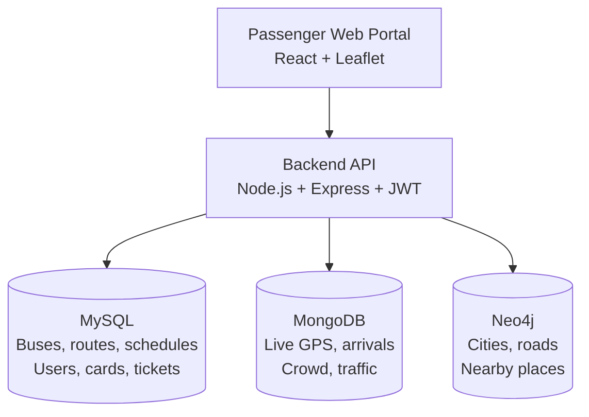

<div align="center">

# 🚌 Smart City Public Transportation

### Multi-database transport management system for Solapur · Tuljapur · Dharashiv · Latur


*Plan journeys, track buses live, check traffic and crowd, and book tickets with an NCMC card, all powered by three databases working together.*

</div>

---

## 📖 Table of Contents
- [About](#-about)
- [Features](#-features)
- [Architecture](#-multi-database-architecture)
- [Tech Stack](#-tech-stack)
- [Project Structure](#-project-structure)
- [Getting Started](#-getting-started)
- [API Reference](#-api-reference)
- [Database Design](#-database-design)
- [Security](#-security)
- [Future Scope](#-future-scope)

---

## 🌆 About

This project is the **Public Transportation module** of a Smart City Digital Platform. Instead of forcing all data into one database, each kind of data lives in the database that fits it best:

- **MySQL** keeps buses, routes, schedules, passengers, NCMC cards, tickets and payments, where ACID transactions matter.
- **MongoDB** stores fast-changing live data such as bus GPS, arrivals, crowd and traffic.
- **Neo4j** models the road network, so shortest paths and nearby places are single queries.

A Node.js and Express backend combines the three, and a React dashboard shows the result.

---

## ✨ Features

| | Feature | Powered by |
|---|---|---|
| 🧭 | **Plan your journey**: road path, distance, stops, fare, buses and timings | Neo4j + MySQL |
| 📍 | **Live bus tracking** on an interactive map | MongoDB + MySQL |
| ⏱️ | **Next arrivals** with delay and status | MongoDB + MySQL |
| 🚦 | **Traffic information** per road with congestion level | MongoDB |
| 👥 | **Crowd information** for every bus stop | MongoDB |
| 📅 | **Bus schedules, routes and bus information** | MySQL |
| 🛣️ | **Road connectivity** between cities | Neo4j |
| 🏥 | **Nearby places**: hospitals, temples, hotels, malls | Neo4j |
| 💳 | **NCMC card recharge and ticket booking** (transactional) | MySQL |
| 🔐 | **Register, login and guest mode** with JWT | MySQL |

---

## 🏗️ Multi-Database Architecture



| Database | Why it was chosen |
|---|---|
| **MySQL** | Fixed structure, foreign keys and ACID transactions, so a fare is never deducted without a ticket |
| **MongoDB** | Heavy writes, GeoJSON positions and a TTL index that removes old locations after 7 days |
| **Neo4j** | Shortest path and nearby-place queries are one traversal instead of many joins |

The databases never talk to each other. They share ids (`bus_id`, `route_id`, `stop_id`) and the backend merges the results.

**Example: Plan your journey**
1. Neo4j returns the shortest road path, total kilometres and number of stops.
2. MySQL returns the buses and timings on that route.
3. The backend adds the fare and sends one JSON response.

---

## 🧰 Tech Stack

| Layer | Technologies |
|---|---|
| Frontend | React, Vite, Leaflet, Lucide icons |
| Backend | Node.js, Express, JWT, bcrypt |
| Databases | MySQL (mysql2), MongoDB (official driver), Neo4j (neo4j-driver) |

---

## 📁 Project Structure

```
smart-city-public-transportation/
├── backend/
│   ├── server.js            # Express API connecting all three databases
│   ├── package.json
│   └── .env.example         # Copy to .env and add your passwords
├── database/
│   ├── mysql_schema.sql
│   ├── mongodb_seed.js
│   └── neo4j_seed.cypher
├── src/
│   ├── App.jsx              # Dashboard
│   ├── LoginPage.jsx
│   ├── Pages.jsx            # Data pages
│   ├── Illustrations.jsx
│   ├── api.js               # Calls the backend
│   └── *.css
├── docs/screenshots/
├── vite.config.js
└── README.md
```

---

## 🚀 Getting Started

### Prerequisites
Node.js 18 or newer, MySQL, MongoDB and Neo4j (Desktop or Community).

### 1. Load the data
| Database | How |
|---|---|
| MySQL | `mysql -u root -p < database/mysql_schema.sql` |
| MongoDB | `mongosh < database/mongodb_seed.js` |
| Neo4j | Open Neo4j Browser and run `database/neo4j_seed.cypher` |

### 2. Start the backend
```bash
cd backend
copy .env.example .env      # Windows (use cp on Mac or Linux)
# open .env and add your MySQL and Neo4j passwords
npm install
npm run dev
```
Open **http://localhost:5000/api/health**. You should see:
```json
{ "mysql": true, "mongodb": true, "neo4j": true }
```

### 3. Start the frontend
Open a second terminal in the project root:
```bash
npm install
npm run dev
```
Open **http://localhost:5173**

---

## 🔌 API Reference

| Method | Route | Database | Description |
|---|---|---|---|
| GET | `/api/health` | All | Connection status of the three databases |
| GET | `/api/dashboard/stats` | MySQL, MongoDB | Dashboard counters |
| GET | `/api/cities` | Neo4j | Cities with coordinates |
| GET | `/api/journey?from=&to=` | Neo4j, MySQL | Path, distance, fare, buses, timings |
| GET | `/api/buses` `/api/routes` `/api/schedules` | MySQL | Master data |
| GET | `/api/live/buses` | MongoDB, MySQL | Live bus positions |
| GET | `/api/arrivals` | MongoDB, MySQL | Estimated arrivals |
| GET | `/api/crowd` `/api/traffic` | MongoDB | Crowd and traffic |
| GET | `/api/connectivity` `/api/nearby` | Neo4j | Roads and nearby places |
| POST | `/api/auth/register` `/api/auth/login` | MySQL | Create user, get JWT |
| POST | `/api/tickets` | MySQL | Book a ticket with an NCMC card |

---

## 🗄️ Database Design

**MySQL (13 tables):** `user_registration`, `operator`, `bus`, `bus_stop`, `bus_route`, `route_stop`, `bus_schedule`, `ncmc_card`, `ncmc_transaction`, `passenger`, `ticket`, `payment`, `receipt`

**MongoDB (5 collections):** `bus_live_locations`, `bus_stop_crowd_snapshots`, `bus_arrival_status`, `route_traffic`, `bus_status_history`

**Neo4j:** labels `City`, `Hospital`, `Temple`, `Hotel`, `ShoppingMall`, with relationships `ROAD_TO` and `LOCATED_IN`

---

## 🔒 Security
- Passwords are stored as bcrypt hashes, never as plain text
- JWT tokens protect the login and recharge routes
- Database passwords stay in `.env`, which is not uploaded to GitHub

---

## 🔭 Future Scope
- Real GPS devices and a message queue for live ingestion
- Delay and crowd prediction with machine learning
- Redis cache and database replication for millions of users
- Mobile app and push notifications

---

<div align="center">

**Built as a Database Architecture case study: Smart City Public Transportation**

⭐ If you like this project, give it a star!

</div>
